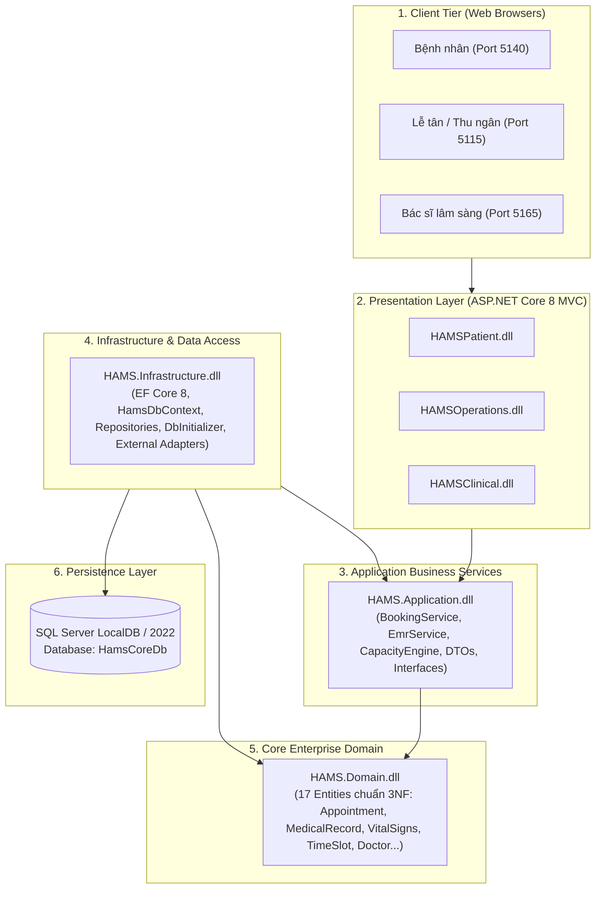

# HAMS - Hospital Appointment & Medical Service Management System
> **Hệ thống Quản trị Đặt lịch khám và Dịch vụ Y tế Ngoại trú**  
> **Môn học:** SWD392 (Software Architecture & Design) – FPT University (Fall 2026)  
> **Lớp:** SE1972-NET | **Nhóm:** Group 4

---

## 👥 Danh Sách Nhóm & Phân Công Nhánh Git (Team Roster & Git Branches)

Dự án được phân chia theo kiến trúc module hóa. Mỗi thành viên phát triển trên một nhánh riêng và tạo Pull Request (PR) hợp nhất vào `main`:

| STT | Họ và Tên | MSSV | Vai trò | Nhánh Git Phụ Trách | Phân Hệ & Chức Năng Chính |
| :---: | :--- | :---: | :---: | :---: | :--- |
| **1** | **Trần Quang Phong** | **HE190966** | **Leader** | `feature/booking-concurrency` | **HAMSPatient (Port 5140):** Cổng bệnh nhân, tra cứu bác sĩ, thuật toán công suất ca (`CapacityEngine`), giữ chỗ chống trùng lịch (**OCC - RowVersion 600s**), xuất vé QR. |
| **2** | **Lê Đức Anh** | **HE191710** | **Member** | `feature/doctor-emr` | **HAMSClinical (Port 5165):** Buồng khám bác sĩ, xem sinh hiệu tiếp đón, chẩn đoán **ICD-10**, kê đơn thuốc điện tử, ký số & in **Bệnh án điện tử EMR** chuẩn Bộ Y Tế. |
| **3** | **Nguyễn Hữu Minh Đức** | **HE191558** | **Member** | `feature/reception-triage` | **HAMSOperations (Port 5115):** Bàn Lễ tân tiếp đón, tra cứu vé QR/SĐT, đo chỉ số sinh tồn (**Vital Signs Triage**), cấp số thứ tự khám động theo giờ hẹn. |
| **4** | **Nguyễn Việt Hà** | **HE191827** | **Member** | `feature/email-automation` | **Email & Background Worker:** Tích hợp SMTP gửi vé khám QR, OTP, `DailyReminderWorker` tự động nhắc hẹn hàng ngày và Dashboard phân tích dữ liệu. |
| **5** | **Nguyễn Xuân Bằng** | **HE190879** | **Member** | `feature/payment-vnpay` | **Tài chính & Dược:** Cổng thanh toán cọc VNPAY Sandbox, Quyết toán viện phí tổng hợp tại quầy thu ngân (Cashier) và Xuất dược kho thuốc (Pharmacy). |

---

## 🏗️ Kiến Trúc Hệ Thống (System Architecture)

Dự án tuân thủ nghiêm ngặt **Kiến trúc 4 tầng chuẩn Doanh nghiệp (Enterprise 4-Tier Clean Architecture)**:



---

## 🚀 Hướng Dẫn Khởi Chạy 1-Click (Quick Start)

Hệ thống đã tích hợp sẵn kịch bản chạy song song 3 phân hệ tự động mở trên trình duyệt:

### 1. Khởi động toàn bộ hệ thống
Nhấp đúp chuột vào file:
```cmd
run_demo.bat
```
*(Hoặc chạy PowerShell: `.\run_demo.ps1`)*

Sau 5 giây, hệ thống sẽ tự động khởi động và mở 3 cổng:
* 🌐 **Cổng Bệnh Nhân:** [http://localhost:5140](http://localhost:5140)
* 🏨 **Cổng Lễ Tân Vận Hành:** [http://localhost:5115](http://localhost:5115)
* 🩺 **Cổng Bác Sĩ & EMR:** [http://localhost:5165](http://localhost:5165)

### 2. Dừng hệ thống & giải phóng Port
Nhấp đúp chuột vào file:
```cmd
stop_demo.bat
```
*(Script sẽ giải phóng toàn bộ các Port 5140, 5115, 5165 an toàn).*

### 3. Làm mới dữ liệu demo (1-Click Reset)
Trên thanh menu trên cùng của bất kỳ phân hệ nào, nhấp nút màu đỏ **[Reset Demo]**. Toàn bộ lịch hẹn của ngày hôm nay sẽ được đưa về trạng thái mở ban đầu để demo lại quy trình từ đầu.

---

## 🛠️ Quy Trình Phối Hợp Git Cho Thành Viên (Git Workflow)

1. **Clone mã nguồn về máy:**
   ```bash
   git clone https://github.com/wangfong232/HAMS.git
   cd HAMS
   ```
2. **Chuyển sang nhánh được phân công của bạn:**
   ```bash
   # Ví dụ Đức Anh:
   git checkout feature/doctor-emr

   # Ví dụ Minh Đức:
   git checkout feature/reception-triage

   # Ví dụ Hà:
   git checkout feature/email-automation

   # Ví dụ Bằng:
   git checkout feature/payment-vnpay
   ```
3. **Cập nhật code mới nhất từ nhánh `main` trước khi code:**
   ```bash
   git pull origin main
   ```
4. **Cam kết và đẩy code lên GitHub:**
   ```bash
   git add .
   git commit -m "feat(module): mo ta tinh nang da hoan thanh"
   git push origin <ten-nhanh-cua-ban>
   ```
5. **Tạo Pull Request (PR):** Vào GitHub tạo PR từ nhánh của bạn vào `main` để Leader review và merge.

---

## 📋 Cấu Trúc Thư Mục Source Code

```text
HAMS/
├── HAMS.Domain/               # Thực thể nghiệp vụ cốt lõi (17 Entities: Appointment, MedicalRecord...)
├── HAMS.Application/          # Logic nghiệp vụ, DTOs, Interfaces, CapacityEngine
├── HAMS.Infrastructure/       # EF Core 8, DbContext, Repository, Seed Data & Reset Demo
├── HAMSPatient/               # Ứng dụng Bệnh nhân đặt lịch trực tuyến (Port 5140)
├── HAMSOperations/            # Ứng dụng Lễ tân tiếp đón, check-in, đo sinh hiệu (Port 5115)
├── HAMSClinical/              # Ứng dụng Bác sĩ khám bệnh, kê đơn, bệnh án EMR (Port 5165)
├── run_demo.bat               # Script 1-Click chạy toàn bộ 3 phân hệ
├── stop_demo.bat              # Script 1-Click dừng toàn bộ tiến trình
├── HAMS.slnx                  # Solution file chuẩn .NET 8
└── README.md                  # Tài liệu hướng dẫn dự án
```
